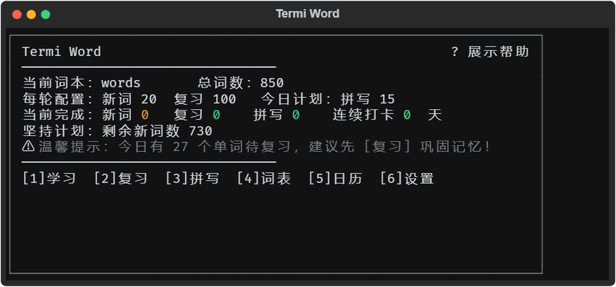
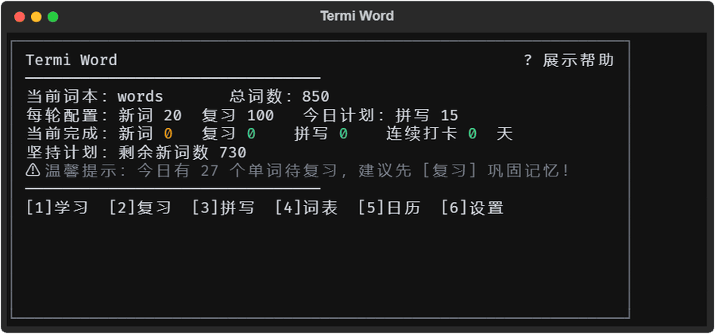
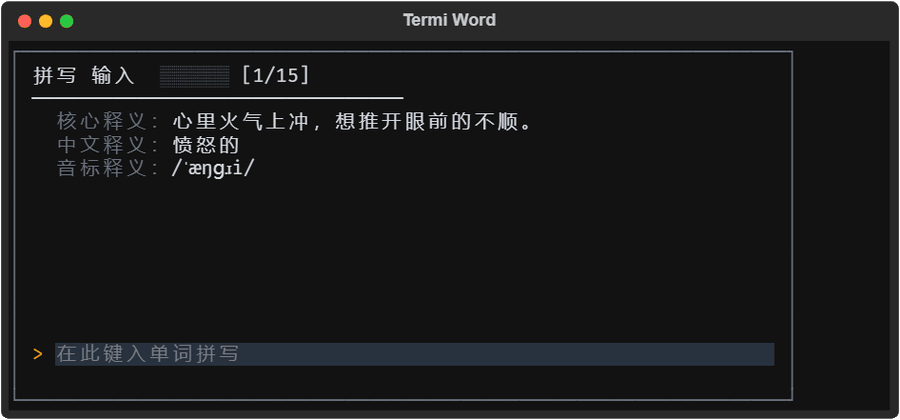
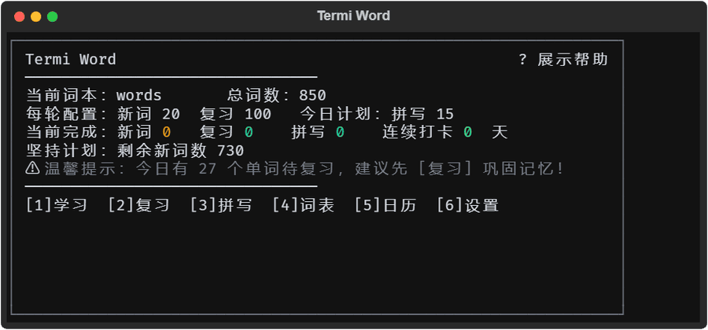
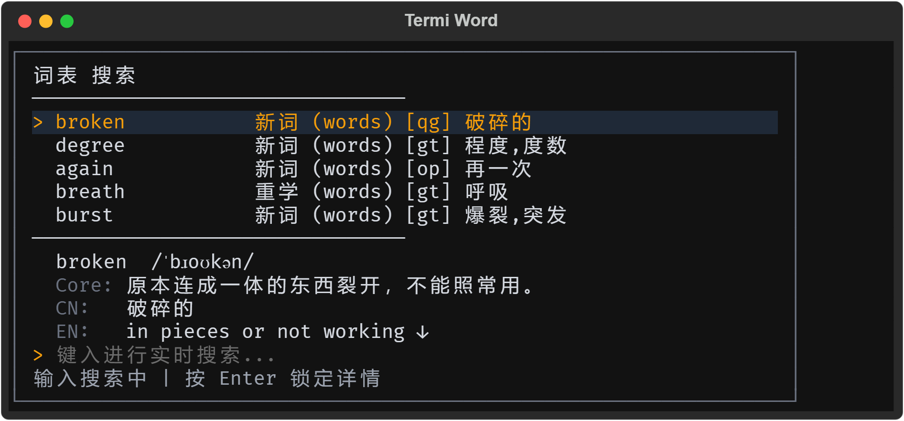
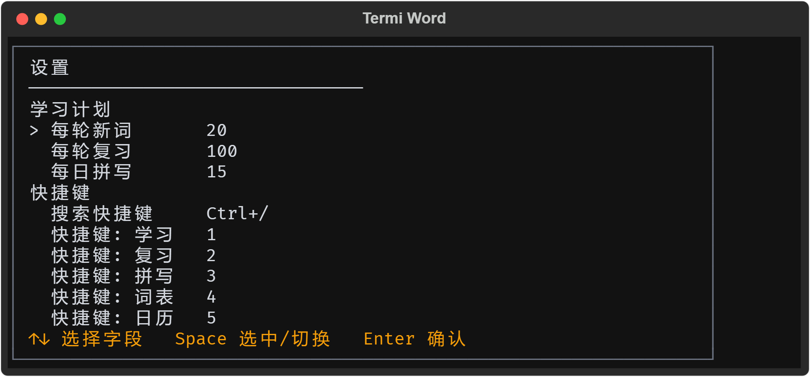

# Termi Word

在电脑上开一个小窗口背单词。不用联网，不用注册，学习记录都保存在你自己的电脑里。程序会按记忆规律帮你安排每个词哪天该复习，你只管每天打开背。

[](https://github.com/ZoraMing/termi_word/releases/latest)
[](https://github.com/ZoraMing/termi_word/releases)



- 窗口很小，可以放在屏幕一角或工作时的额外终端，工作间隙背几个词。
- 全程用键盘操作，不用鼠标。
- 自带 850 个基础英语单词，以及四级（CET4）、六级（CET6）、雅思（IELTS）词书，下载后就能开始背。
- 背单词、拼写练习、查词、打卡日历都有。
- 可以换成你自己用 Excel 做的单词表。

## 下载

| 操作系统 | 下载地址 |
|:---|:---|
| Windows 10 / 11 | [termi_word_windows.zip](https://github.com/ZoraMing/termi_word/releases/latest/download/termi_word_windows.zip) |
| Mac（Apple 芯片：M1、M2、M3、M4 等） | [termi_word_mac_arm64.tar.gz](https://github.com/ZoraMing/termi_word/releases/latest/download/termi_word_mac_arm64.tar.gz) |
| Linux（64 位） | [termi_word_linux_amd64.tar.gz](https://github.com/ZoraMing/termi_word/releases/latest/download/termi_word_linux_amd64.tar.gz) |

不确定自己的 Mac 是哪种芯片：点屏幕左上角的苹果图标，选"关于本机"，看"芯片"一栏。写着 Apple M 开头的就可以用；写着 Intel 的，目前没有对应的安装包。

所有历史版本在 [Releases 页面](https://github.com/ZoraMing/termi_word/releases)。

## 开始使用

### Windows

1. 下载 termi_word_windows.zip。
2. 在下载的文件上点右键，选"全部解压缩"，再点"提取"。会得到一个 termi_word_windows 文件夹。
3. 打开这个文件夹，找到 termi-word.exe 双击。文件夹里文件很多，可以在右上角的搜索框输入 termi-word 快速找到。
4. 弹出一个黑色窗口，就是程序本身。也可以将 termi-word.exe 拖动放到 PowerShell 或 cmd 窗口直接运行


以后想打开得方便些：在 termi-word.exe 上点右键，选"发送到"→"桌面快捷方式"（Windows 11 要先点"显示更多选项"），之后双击桌面图标就能打开。注意不要把 termi-word.exe 单独复制或移动出来，它需要和文件夹里的其他文件放在一起才能运行。

### Mac

1. 下载 termi_word_mac_arm64.tar.gz，双击解压，得到一个文件夹。
2. 打开文件夹，双击 termi-word，会打开"终端"窗口并启动程序。
3. 如果提示"无法打开，因为无法验证开发者"，打开"系统设置"→"隐私与安全性"，在页面下方找到关于 termi-word 的提示，点"仍要打开"，然后再双击一次 termi-word。

如果按上面做了还是打不开，看后面常见问题里的处理办法。

### Linux

```bash
mkdir -p ~/termi_word
tar -xzf termi_word_linux_amd64.tar.gz -C ~/termi_word
~/termi_word/termi-word
```

### 在终端输入 tw 启动（可选）

设置一次以后，打开任意终端窗口，输入 tw 回车就能启动，不用再去找文件夹。先把程序文件夹放到一个固定位置，设置完就不要再移动它，移动后需要重新设置。

Windows：

1. 打开程序文件夹（里面能看到 termi-word.exe 的那一层）。
2. 点文件夹窗口上方的地址栏，把里面的文字删掉，输入 powershell 回车，会打开一个蓝色或黑色的 PowerShell 窗口。
3. 把下面两行复制进去，回车。第一行在程序文件夹里建一个名叫 tw 的启动文件，第二行让系统记住这个文件夹的位置：

```powershell
Set-Content tw.cmd '@"%~dp0termi-word.exe" %*' -Encoding ascii
[Environment]::SetEnvironmentVariable("Path", [Environment]::GetEnvironmentVariable("Path", "User") + ";$PWD", "User")
```

4. 关掉这个窗口。以后打开 PowerShell、"终端"或命令提示符（cmd）都可以，输入 tw 回车即可。也可以按 Win + R，输入 tw 回车直接启动。

Mac（zsh）：

1. 打开"终端"
2. 输入 cd 和一个空格，先不要回车，把程序文件夹从访达拖进终端窗口，再按回车。
3. 复制下面一行进去，回车：

```bash
echo "alias tw='$PWD/termi-word'" >> ~/.zshrc && source ~/.zshrc
```

Linux（bash），按上面的解压位置：

```bash
cd ~/termi_word
echo "alias tw='$PWD/termi-word'" >> ~/.bashrc && source ~/.bashrc
```

之后在任意终端输入 tw 就能快速启动。同一个设置只需要做一次，重复执行会在配置里留下重复的内容。

## 背第一组单词



打开后看到的是首页。按 1 开始学习：

1. 屏幕上出现一个单词，先在心里想一想它的意思。
2. 按空格键翻面，看中文释义和例句。
3. 按数字键给自己打分：

| 按键 | 意思 | 什么时候按 |
|:---|:---|:---|
| 1 | 陌生 | 完全没想起来，很快会再让你复习 |
| 2 | 熟悉 | 想了半天才想起来，或者只想起一部分 |
| 3 | 记得 | 正常想起来了，大多数时候按这个 |
| 4 | 掌握 | 一看就会，很久之后才会再出现 |

4. 打完分再按一次空格，确认并进入下一个词。打分后、按空格前，还可以换成别的分数。
5. 想休息了按 Esc 回首页，已经背过的词都会保存。

也可以不翻面直接按 1 到 4，程序会翻面并记下这个分数，看完释义再按空格确认。

## 怎么用

首页有六个入口，按对应的数字键进入：

| 按键 | 功能 |
|:---|:---|
| 1 | 学习：学新单词，有该复习的词时会穿插着出现（大约每 3 个复习词配 1 个新词） |
| 2 | 复习：只过一遍该复习的词 |
| 3 | 拼写：看中文释义，拼出单词 |
| 4 | 词表：浏览和搜索词书里的所有单词 |
| 5 | 日历：看每天的打卡情况 |
| 6 | 设置：调整每天的数量、换词书 |

建议每天按这个顺序来：先 2 复习，再 1 学新词，最后 3 拼写。

哪个词哪天该复习，程序会根据你的打分自动安排（使用 FSRS 记忆算法），不需要你自己记。有该复习的词时，首页会提示待复习的数量

### 拼写



屏幕上显示中文释义和音标，直接打出这个单词，按 Enter 判断对错，再按 Enter 进入下一题。想不起来时按 Tab，会帮你补出下一个字母。拼错的词会重新安排复习。

### 查词



在任何页面按 Ctrl + / 都能打开查词，输入几个字母就会列出匹配的单词。用 ↑ ↓ 选择，按 Enter 锁定下方的详细释义，锁定后可以用 ↑ ↓ 翻看更长的内容。按 Ctrl + F 只看收藏过的单词。

### 打卡日历



绿色的日期表示那天学过。日历下方也可以修改每轮新词、每轮复习和每日拼写的数量：用 ↑ ↓ 选择，按空格修改，输入数字后按 Enter 保存。

### 调整每天的数量

按 6 进入设置。"每轮新词"默认是 20 个，"每日拼写"默认是 15 个。用 ↑ ↓ 选中要改的项，按 Enter，输入新的数字，再按 Enter 保存。



## 换成自己的单词书

程序自带 words（850 个基础词）、CET4（3739 词）、CET6（2078 词）、IELTS（3427 词）四本词书，默认使用 words，可以在设置里的"词书与映射管理"切换。你也可以用 Excel 做一份自己的单词表，换着背。

1. 用 Excel 新建一个表格，第一行写列名，从第二行开始每行一个单词。第一行要把下面 8 个列名都写上，顺序不限。w 列必须填单词，其他列没有内容可以空着，但列名不能省，少了列名程序会提示"词表字段缺失"。

| 列名 | 填什么 | 例子 |
|:---|:---|:---|
| w | 单词（必填） | come |
| zh | 中文释义（建议填） | 来,前来 |
| us | 音标 | /kʌm/ |
| en | 英文释义 | move toward the speaker or a place |
| c | 分类，比如词性 | op |
| core | 一句话讲清这个词的核心意思 | 朝说话者或目标靠近，让彼此距离变短。 |
| ex | 英文例句 | Come here when you're ready. |
| exz | 例句的中文翻译 | 准备好了就过来。 |

2. 保存时选"另存为"，文件类型选"CSV UTF-8(逗号分隔)(*.csv)"。一定要选带 UTF-8 的这一项，选普通的"CSV(逗号分隔)"，程序读不了里面的中文，单词导入不进来。文件名就是词书的名字，比如"考研词汇.csv"。用 WPS 等其他软件时，也要选 UTF-8 编码的 CSV。
3. 打开程序文件夹里的 termi_data 文件夹，再打开其中的 imports 文件夹，把文件放进去，和自带的 words.csv 放在一起。
4. 在程序里按 6 进入设置，用 ↓ 移到最下面的"词书与映射管理"，按 Enter。
5. 在列表里选中你的文件，按 Enter 启用。程序会自动读取里面的单词，回到首页就能开始背。

可以参考自带词书的写法，下面是它的前几行。完整文件在 [termi_data/imports/words.csv](termi_data/imports/words.csv)，打开后点右上角的下载按钮就能保存下来，用 Excel 打开改成自己的单词。

```csv
w,c,zh,en,us,core,ex,exz
come,op,"来,前来",move toward the speaker or a place,/kʌm/,朝说话者或目标靠近，让彼此距离变短。,Come here when you're ready.,准备好了就过来。
get,op,"得到,获得;变得","obtain, become, or receive",/ɡɛt/,把东西收到手里，或让状态变成新的样子。,I'll get a new book tomorrow.,我明天会买本新书。
give,op,"给,赠予",transfer something to another,/ɡɪv/,把自己这边的东西交到别人那边，让所有权换手。,Please give me your hand.,请把手伸给我。
go,op,"去,离开",move away or proceed,/ɡoʊ/,离开当前位置，朝另一个地方移动过去。,We go to school every day.,我们每天都去学校。
```

### 表格的列名不是 w、zh 怎么办

最简单的办法是把表格第一行改成上面的 8 个列名。不想改表格的话，比如你的表格只有"单词""释义"两列，可以告诉程序哪一列是什么：

1. 在"词书与映射管理"页面先启用这本词书。这时会提示"同步失败！词表字段缺失"，是正常的，继续往下做。
2. 用 ↓ 移到"单词映射(w)"，按 Enter，输入你表格里的列名，比如"单词"，再按 Enter。
3. 用同样的方法把"中文映射(zh)"设成"释义"。
4. 其余你表格里没有的项，比如"英文映射(en)""音标映射(us)"，也要逐个选中，按两次 Enter（打开后什么都不输入，直接确认），告诉程序这一列不用。只显示"(未绑定)"而没有这样确认过的项，同步时仍会提示字段缺失。
5. 移到"同步当前词书"，按 Enter，看到"同步成功"就可以回首页开始背了。

### 修改词书里的内容

发现释义写错了，或者想补充例句，直接用 Excel 改 imports 文件夹里的那个文件并保存，然后进入"词书与映射管理"，选"同步当前词书"按 Enter。已经背过的进度会保留。

## 常见问题

<details>
<summary>Windows 上双击 termi-word.exe 没反应，或者一闪就关掉了</summary>

先确认已经解压。直接在压缩包里双击是运行不了的，要先右键"全部解压缩"，再到解压出来的文件夹里双击。另外，termi-word.exe 不能单独拿出来用，需要和文件夹里的其他文件放在一起。

</details>

<details>
<summary>Mac 上已经点了"仍要打开"，还是提示无法打开</summary>

可以一次性解除整个文件夹的系统拦截。打开"终端"（在"启动台"里搜索"终端"），输入下面这行，把路径换成你解压出来的文件夹，按回车：

```bash
xattr -dr com.apple.quarantine ~/Downloads/termi_word_mac_arm64
```

不知道路径的话，可以先输入 `xattr -dr com.apple.quarantine ` （末尾有一个空格），然后把文件夹拖进终端窗口，路径会自动填上，再按回车。

</details>

<details>
<summary>界面显示不全，或者中文没有对齐</summary>

把窗口拉大一些，程序会自动适应窗口大小。内容放不下时，可以用 ↑ ↓ 滚动查看。在 Windows 10 上如果中文对不齐，可以试试用"Windows 终端"打开（Windows 11 自带，Windows 10 可以在微软商店免费安装）。

</details>

<details>
<summary>怎么退出</summary>

在首页快速连按两次 Esc，或者按 Ctrl + Q。退出前会自动保存。

</details>

<details>
<summary>学习记录存在哪里，怎么备份，换电脑怎么办</summary>

都在程序文件夹里的 termi_data 文件夹中：termi_word.sqlite3 是你的学习记录和设置，imports 文件夹里是词书。备份或者换电脑时，把整个 termi_data 文件夹复制走就行。

</details>

<details>
<summary>升级到新版本会丢失进度吗</summary>

不会。把新版本解压到一个新文件夹，再把旧文件夹里的 termi_data 整个复制过来，覆盖新文件夹里的同名文件夹，然后用新文件夹里的程序打开。

</details>

<details>
<summary>有些词已经会了，不想再背</summary>

背单词时遇到这个词，按 t，再按 y 确认，这个词以后就不会再出现在背单词和拼写里。

</details>

<details>
<summary>想把某些词收藏起来</summary>

背单词时按 f 收藏，卡片顶部的进度后面会出现一个 * 号，再按一次取消。在查词页按 Ctrl + F 可以只看收藏的词。

</details>

## 按键速查

在大多数页面按 ? 可以显示或隐藏底部的按键提示。

在任何页面都能用：

| 按键 | 作用 |
|:---|:---|
| Ctrl + / | 查词 |
| Esc | 返回上一页；在首页快速按两次退出 |
| Ctrl + Q、Ctrl + Z、Ctrl + C | 退出 |
| ? | 显示或隐藏按键提示 |

背单词和复习时：

| 按键 | 作用 |
|:---|:---|
| 空格 / Enter | 翻面；翻面后确认分数并进入下一个词 |
| 1 / 2 / 3 / 4 | 打分：陌生 / 熟悉 / 记得 / 掌握 |
| s | 跳过这个词，不打分 |
| t | 这个词以后不再出现（再按 y 确认，Esc 取消） |
| f | 收藏或取消收藏 |
| ↑ / ↓ | 释义太长时上下滚动 |
| Esc | 回首页，已背的进度会保存 |

拼写时：

| 按键 | 作用 |
|:---|:---|
| 字母键 | 输入单词 |
| Enter | 判断对错；判断后进入下一题 |
| Tab | 提示下一个字母 |
| ↑ / ↓ | 释义太长时上下滚动 |
| Esc | 回首页 |

查词时：

| 按键 | 作用 |
|:---|:---|
| 字母键 | 输入要查的词，结果实时更新 |
| ↑ / ↓ | 选择单词；锁定详情后用来滚动释义 |
| Enter / 空格 | 锁定或解锁下方的详细释义 |
| Ctrl + F | 只看收藏的词（输入框外也可以直接按 f） |
| Esc | 解锁详情或离开输入框；再按一次回首页 |

## 进阶用法

下面的内容需要用到命令行，不影响日常使用，可以跳过。

<details>
<summary>把 JSON 格式的词表转换成 CSV</summary>

需要电脑上装有 Python 3，并下载本项目的 [scripts/convert_json.py](scripts/convert_json.py)。第二个参数是输出位置，指向程序文件夹里的 termi_data/imports，转换完就能在"词书与映射管理"里看到：

```bash
python convert_json.py my_words.json D:\termi_word_windows\termi_data\imports\my_words.csv
```

不写第二个参数时，结果保存到当前目录下的 termi_data/imports/my_words.csv。

支持这几种写法：对象数组（每个对象是一个词）、带 words 列表的对象、"单词: 释义"的键值对、每行一个 JSON 对象（JSON Lines）。常见的键名会自动识别，比如 word、headWord、translation、meaning、phonetic、example。需要识别其他键名时，在脚本顶部的 FIELD_MAP 里添加。

</details>

<details>
<summary>从源码运行和打包</summary>

见 [docs/development.md](docs/development.md)。

</details>
